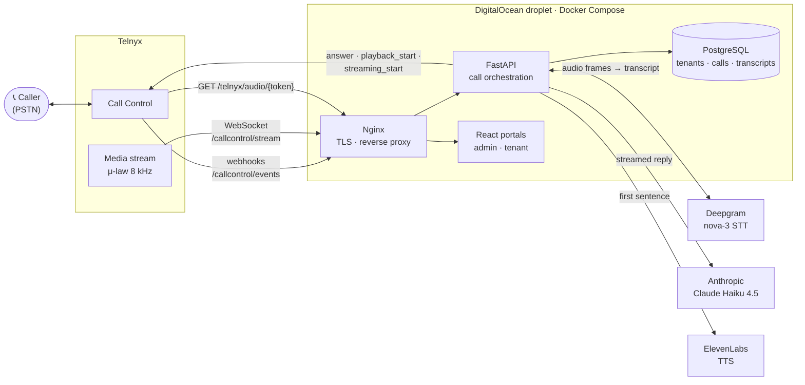
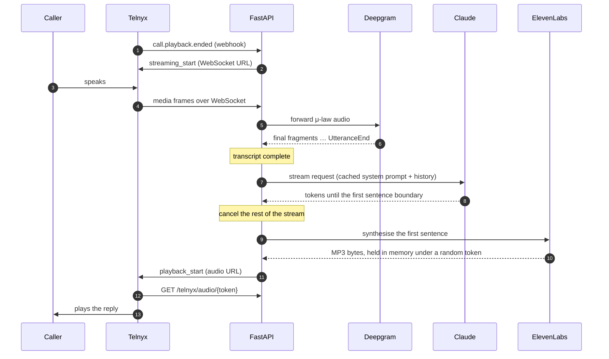
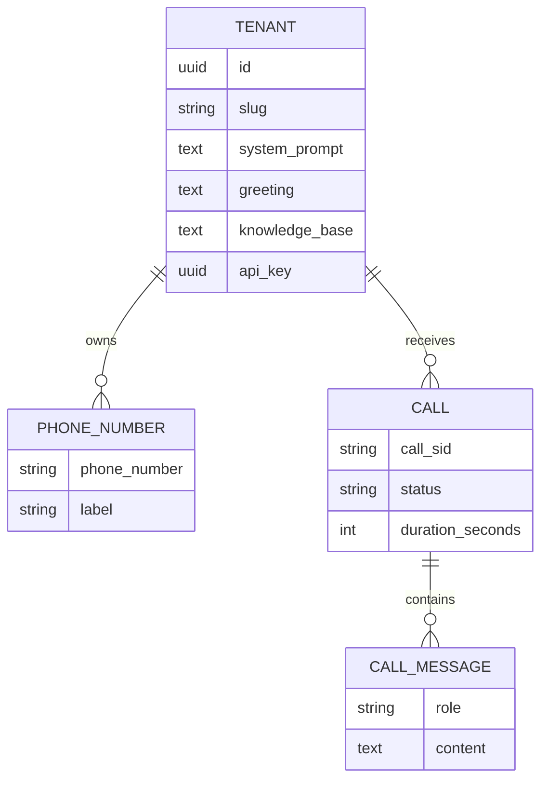

# AI Infoline

**An AI phone assistant for small businesses, delivered as multi-tenant SaaS.**
A caller dials a business number and talks to a voice agent that answers from that business's own prompt and knowledge base. Every turn runs through streaming speech-to-text, an LLM and text-to-speech in real time, and the owner sees each call and transcript in their own portal.

Live at [infoline.dev](https://infoline.dev) · Built and operated by [István Jancso](https://linkedin.com/in/istvanjancso)

| | |
|---|---|
| **Telephony** | Telnyx Call Control + bidirectional webhooks, media streaming over WebSocket |
| **Speech-to-text** | Deepgram `nova-3`, streaming over WebSocket (μ-law, 8 kHz) |
| **LLM** | Anthropic Claude Haiku 4.5, streamed, with prompt caching |
| **Text-to-speech** | ElevenLabs `eleven_turbo_v2_5`, streaming API |
| **Backend** | Python 3.12 · FastAPI (async) · SQLAlchemy 2 (async) · Alembic |
| **Frontend** | React 18 · Vite · Tailwind CSS, served by Nginx (admin + tenant portals) |
| **Data** | PostgreSQL 16 · DigitalOcean Spaces (S3-compatible) |
| **Infrastructure** | Docker Compose on a DigitalOcean droplet · Terraform (managed PostgreSQL, Spaces) · Let's Encrypt |

---

## How a call works



Incoming calls are matched to a tenant by the dialled number. The tenant's greeting, system prompt and knowledge base shape every reply, and each turn is stored with its transcript.

## One conversational turn

The latency of a voice agent is the sum of a relay race. This is the exact sequence the code runs (`api/routers/callcontrol.py`, `api/services/claude_service.py`):



Two design choices keep the turn short:

- **Stream the LLM and stop at the first sentence.** Text-to-speech starts as soon as the first sentence is complete, and the rest of the stream is cancelled; the prompt asks for a short, two-sentence answer shaped for speech.
- **Cache the system prompt.** The base prompt, the tenant prompt and the knowledge base are sent with `cache_control: ephemeral`, so repeated turns in a call do not pay for them again.

## Measuring latency

Callers reported waiting **5–6 seconds** for an answer, so the latency work starts with measurement, not guesses.

| Tool | What it measures |
|---|---|
| `LATENCY_DEBUG=1` (`api/services/latency_debug.py`) | One log line per stage per turn: `speech_end_detected → stt_done → db_ready → llm_request_sent → llm_first_token → llm_done → tts_first_audio → audio_sent`. Off by default, no behaviour change. |
| `call_emulator.py` | The LLM + TTS middle of the pipeline, without a phone. |
| `RECORD_CALLS=1` + `docs/latency-post/measure_gaps.py` | Dual-channel recordings of test calls; the gap between the caller's last word and the first word of the reply is what the caller actually waits. |
| `docs/latency-post/auto_caller.py` | An automated caller that plays the same scripted questions on every run, so before/after comparisons are fair. Guarded: test number only, capped call count, cost estimate printed. |

First measurement on the production host (two emulator turns, 2026-10-05, from [`LATENCY_REPORT.md`](LATENCY_REPORT.md)):

| Stage | Measured |
|---|---|
| Request sent → first LLM token (Claude Haiku 4.5) | 420–501 ms |
| First token → first full sentence | 208–425 ms |
| Sentence → synthesised audio | 376–383 ms *(Google TTS at the time, since replaced by ElevenLabs)* |
| **LLM + TTS combined** | **1.15–1.22 s** |

The middle of the pipeline accounts for only about 1.2 s of the reported 5–6 s, which moved the investigation to the stages around it: end-of-speech detection, Telnyx signalling and the audio fetch before playback. The measured before/after results of each fix will be published under `docs/latency-post/`, one commit per change.

## Engineering decisions

| Decision | Why | Commit |
|---|---|---|
| Telnyx Call Control instead of Twilio TwiML | Number coverage for Hungary and New Zealand; media streaming makes a WebSocket STT pipeline possible | `221d1d7` |
| Deepgram `nova-3` with smart formatting | Higher recognition accuracy on phone-quality audio | `caf7544` |
| Stream Claude and start TTS at the first sentence | Overlaps LLM generation with speech synthesis | `9f5fdfd` |
| ElevenLabs streaming TTS (replacing Google Cloud TTS) | Streaming synthesis and one shared HTTP client instead of a new connection per request | `eb24776` |
| End of utterance only on `UtteranceEnd` | Multi-fragment sentences were being cut short | `7f04d7a` |
| Opt-in per-turn instrumentation | Measure every stage in production without changing behaviour | `95f6a5f` |

Not every experiment worked: shorter speech timeouts cut callers off mid-sentence and had to be raised again, and the fastest built-in TTS voice sounded wrong for the language. Both are in the history.

## Multi-tenancy and data



- **Admin portal** (`X-Admin-Key`): create tenants, assign phone numbers, read all calls.
- **Tenant portal** (`X-Tenant-Key`, one key per tenant): edit greeting, system prompt and knowledge base; see own numbers, calls and transcripts. Every portal query is scoped to the authenticated tenant.
- Schema changes are Alembic migrations, applied automatically at API start-up.

## Repository layout

```
api/
  main.py                  FastAPI app, router wiring, migrations on start-up
  routers/
    callcontrol.py         Telnyx Call Control webhooks + media-stream WebSocket (live path)
    callcontrol_caller.py  Webhooks for the automated test caller
    admin.py · portal.py   Admin and tenant REST APIs
    telnyx_webhook.py      Serves synthesised audio to Telnyx
  services/
    claude_service.py      Streaming LLM, first-sentence cut-off, conversation history
    tts_service.py         ElevenLabs streaming TTS
    callcontrol_service.py Telnyx Call Control actions
    latency_debug.py       Opt-in per-turn timers
  alembic/                 Database migrations
frontend/                  React admin + tenant portals (Vite, Tailwind, Nginx)
terraform/                 DigitalOcean managed PostgreSQL + Spaces
docs/latency-post/         Latency measurement tooling and write-up
call_emulator.py           LLM + TTS latency without a phone call
LATENCY_REPORT.md          First stage-by-stage latency investigation
```

## Running it

```bash
cp .env.example .env      # fill in the API keys
docker compose up --build
```

- API: http://localhost:8001 (OpenAPI docs at `/docs`)
- Portals: http://localhost
- Telephony needs a public HTTPS host: point a Telnyx Call Control application's webhook at `https://<host>/callcontrol/events`.

Production runs `docker-compose.prod.yml` behind Nginx with Let's Encrypt certificates. Terraform (`terraform/`) provisions a DigitalOcean managed PostgreSQL cluster and a Spaces bucket; the droplet itself is not Terraform-managed yet.

## Status and roadmap

**Built**

- Live inbound calls on Telnyx with streaming STT, LLM and TTS
- Multi-tenant model with per-tenant greeting, prompt and knowledge base
- Admin and tenant portals with call history and transcripts
- Opt-in latency instrumentation, call recording for test calls, automated test caller

**Next**

- Latency fixes in measured steps: shared HTTP client for Telnyx actions, DB writes off the hot path, end-of-speech tuning, then streaming TTS audio back over the media WebSocket instead of a playback URL
- Signature verification on the Call Control webhook path
- Automated tests in CI: API tests, Playwright end-to-end tests for the portals, and LLM evaluation cases including prompt-injection and hostile-caller scenarios
- Stripe subscription billing (the data model has the customer field; billing is not implemented yet)
- Retire the legacy TwiML/Twilio code paths

## License

All rights reserved. The code is published to show how the system works; please ask before reusing it.
